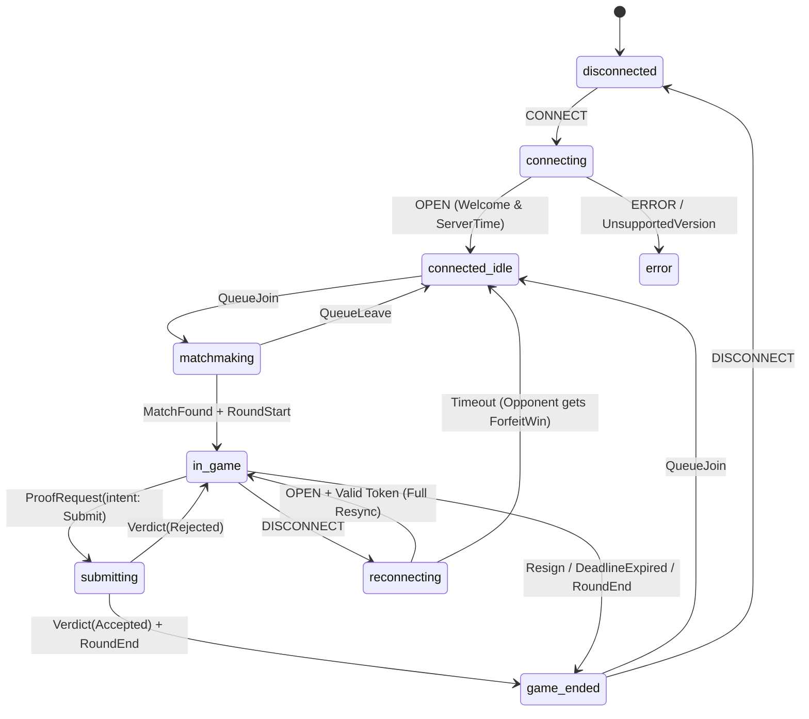
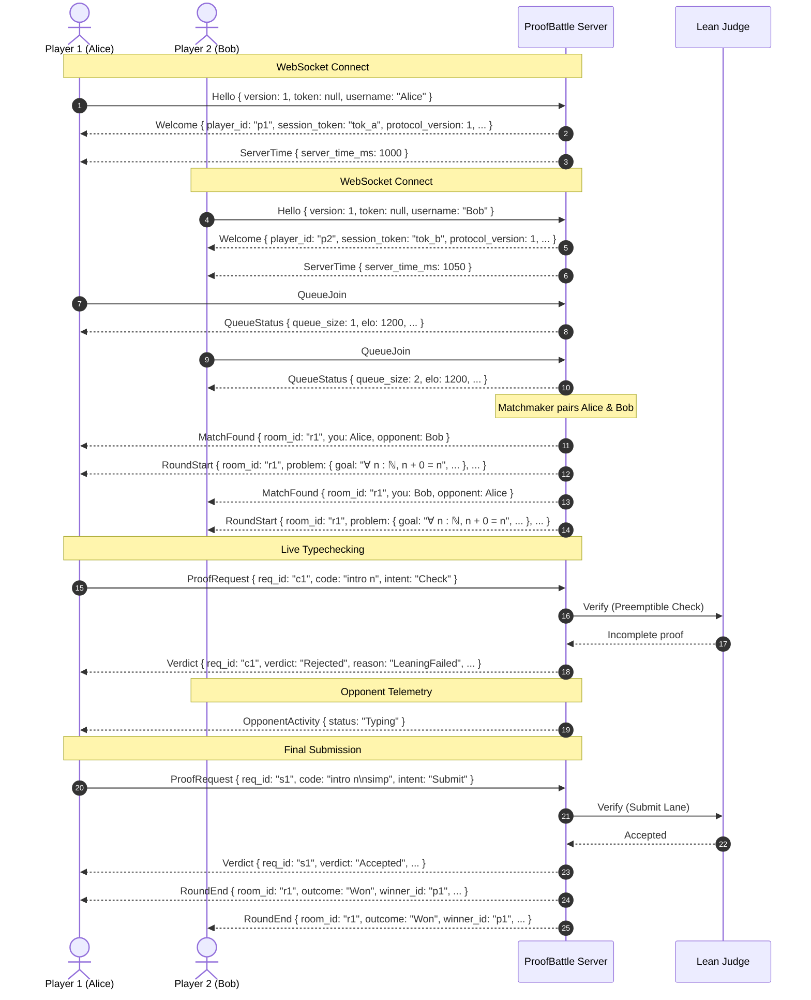

# ProofBattle Wire Protocol v1 (Normative)

This document specifies the wire protocol between the ProofBattle frontend client and the backend server over WebSocket.

The Rust definitions in [`server/src/ws/message.rs`](file:///home/gulshansharma/proof_battle/server/src/ws/message.rs) and the generated TypeScript bindings in [`frontend/src/lib/ws/generated.ts`](file:///home/gulshansharma/proof_battle/frontend/src/lib/ws/generated.ts) form the authoritative implementation. Run `make codegen` to synchronize types.

---

## 1. Framing & Wire Invariants

1. **Discriminator**: Every frame is a JSON object with a top-level `"type"` string property indicating the variant.
2. **Naming Convention**:
   - Variant names: `PascalCase` (e.g. `"ProofRequest"`, `"MatchFound"`, `"RoundStart"`).
   - Field names: `snake_case` (e.g. `req_id`, `server_time_ms`, `elo_delta`).
3. **Constitution Invariant 1 (No Client-Supplied Identity)**:
   - No `ClientMessage` variant may contain `player_id`, `room_id`, `winner`, or `elo`.
   - Player identity and room assignment are server-bound and derived entirely from the authenticated connection socket.
   - Any unknown or unauthorized fields sent by the client are strictly rejected at deserialization with `deny_unknown_fields`.
4. **ADR-002 (Tactic-Body-Only Submissions)**:
   - In `ProofRequest { code }`, the `code` field contains ONLY the player's tactic body. Imports, theorem statements, and safety preambles are server-owned.

---

## 2. Client → Server Messages

| Type | Payload Fields | Legal Connection States | Notes |
| :--- | :--- | :--- | :--- |
| `Hello` | `version: u32`<br>`token: Option<String>`<br>`username: Option<String>` | `connecting` | MUST be the first frame. `token` is the session token from a previous `Welcome`. |
| `QueueJoin` | `{}` | `connected_idle`, `reattaching` | Joins the matchmaking queue. |
| `QueueLeave` | `{}` | `matchmaking` | Leaves/cancels matchmaking. |
| `ProofRequest` | `req_id: String`<br>`code: String`<br>`intent: "Submit" \| "Check"` | `in_game`, `submitting` | `intent: "Check"` performs live background verification without affecting game state or consuming submit rate limits. |
| `Resign` | `{}` | `in_game`, `submitting` | Concedes match immediately, triggering `RoundEnd` (`ForfeitLoss`/`ForfeitWin`). |
| `Pong` | `ts: i64` | Any connected state | Heartbeat response to server `Pong`/Ping. |

---

## 3. Server → Client Messages

| Type | Payload Fields | Description |
| :--- | :--- | :--- |
| `Welcome` | `player_id: String`<br>`session_token: String`<br>`server_time_ms: i64`<br>`heartbeat_interval_ms: i64`<br>`protocol_version: u32` | Identity assigned by the server. Token is persisted for session resumption. |
| `ServerTime` | `server_time_ms: i64` | Emitted every 15 s. Used by the client to compute monotonic clock offset (ADR-004). |
| `QueueStatus` | `queue_size: u32`<br>`elo: i32`<br>`search_range: { min_elo: i32, max_elo: i32 }` | Matchmaking telemetry update. |
| `MatchFound` | `room_id: String`<br>`you: PlayerInfo`<br>`opponent: PlayerInfo` | Dispatched when two players are matched. Never exposes opponent code. |
| `RoundStart` | `room_id: String`<br>`problem: Problem`<br>`starts_at_ms: i64`<br>`ends_at_ms: i64`<br>`duration_ms: i64`<br>`server_time_ms: i64`<br>`seq: u64` | Round initiation and resynchronization state on reconnect. |
| `Verdict` | `req_id: String`<br>`verdict: "Accepted" \| "Rejected" \| "Error"`<br>`reason: Option<RejectReason>`<br>`message: String`<br>`diagnostics: Diagnostic[]`<br>`elapsed_ms: u64`<br>`check_skipped: bool` | Verification result correlated by `req_id`. Line numbers in diagnostics are 1-based and relative to the player's tactic body. |
| `OpponentActivity` | `status: "Idle" \| "Typing" \| "Checking" \| "Verifying" \| "Submitted"` | Server-inferred telemetry. Never exposes code or keystrokes. |
| `RoundEnd` | `room_id: String`<br>`outcome: "Won" \| "Lost" \| "Draw" \| "ForfeitWin" \| "ForfeitLoss"`<br>`winner_id: Option<String>`<br>`winning_proof: Option<String>`<br>`canonical_proof: Option<String>`<br>`elo_delta: i32`<br>`duration_ms: i64`<br>`seq: u64` | Terminal match summary. Both players receive the identical `outcome` enum variant. |
| `ServerError` | `code: String`<br>`message: String`<br>`retry_after_ms: Option<u64>`<br>`retryable: bool` | Error notification (`bad_request`, `invalid_state`, `rate_limited`, `busy`, `unsupported_version`, `internal`). |
| `Pong` | `ts: i64` | Server heartbeat ping echo. |

---

## 4. Supporting Types

```typescript
export type ProofIntent = "Submit" | "Check";

export type SearchRange = {
  min_elo: number;
  max_elo: number;
};

export type PlayerInfo = {
  player_id: string;
  username: string | null;
  elo: number;
};

export type Problem = {
  id: string;
  goal: string;
  imports: string[];
  difficulty: number;
  category: string;
  hint: string | null;
  duration_ms: bigint;
};

export type DiagnosticSeverity = "error" | "warning" | "info";

export type Diagnostic = {
  line: number;
  col: number;
  end_line: number;
  end_col: number;
  severity: DiagnosticSeverity;
  message: string;
};
```

---

## 5. Connection State Machine



---

## 6. Full Match Lifecycle Sequence


